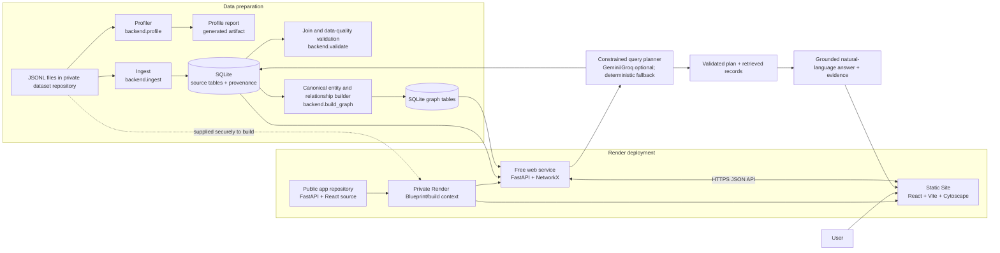

# SAP Order-to-Cash Context Graph

**Explore SAP-style order-to-cash records as a connected graph, then ask grounded questions in plain language.** The application profiles source data, stages it in SQLite, constructs verified business relationships, and serves an interactive graph and conversational query interface.

[Open the live dashboard](https://sap-o2c-dashboard.onrender.com) · [Public application repository](https://github.com/Adnanjawed007/sap-order-to-cash-context-graph) · [API health](https://sap-o2c-api.onrender.com/api/health) · [Interactive API docs](https://sap-o2c-api.onrender.com/docs)

> The public source repository intentionally excludes the business dataset. The dataset lives in a separate private GitHub repository and is supplied to the Render build/deployment workflow. Do not put dataset files, credentials, or API keys in the public repository.

## The problem

Order-to-cash information is spread across separate exports for orders, items, deliveries, billing, customers, products, and accounting. A person investigating a question such as “Which journal entry is linked to this billing document?” must identify the right files, understand their identifiers, reconcile item-number formatting, and follow document references across tables. A spreadsheet view obscures those connections, while a static FAQ cannot answer questions grounded in changing records.

## What this project does

1. **Profiles and stages the source.** JSONL files are inventoried and profiled. Source values are retained as text, provenance is recorded, and malformed lines are captured as ingestion diagnostics.
2. **Models verified links.** Canonical entities and relationships are built from explicit source references and auditable join rules. The graph is persisted in SQLite and projected into NetworkX for traversal.
3. **Lets people explore.** The dashboard provides search, a Cytoscape relationship graph, focused document traces, node hover previews, click-to-pin properties, and neighbor expansion.
4. **Answers natural-language questions.** An optional Gemini or Groq planner maps the request into a constrained, validated query plan. The backend runs supported operations against the data and produces a readable answer with retrieved evidence. It never executes SQL written by the model. With no provider configured, a deterministic planner supports known query patterns and reports that fallback in the response.

Supported query families include document trace, customer order lookup, billing summaries, top products, and incomplete-flow checks. Ambiguous customer/product requests can ask for clarification. See the API section for endpoints and examples.

## Architecture



### Request and data flow

- **Source boundary:** The private dataset repository is the source for JSONL records. The public repository contains application code, dependency manifests, documentation, and deployment configuration only. `.gitignore` excludes raw/processed data, environment files, frontend dependencies, and generated artifacts.
- **Build and initialization:** The private Render Blueprint/build context checks out the public application code and makes the private dataset available to the API build. The build installs dependencies, profiles the source, ingests it into SQLite, validates joins, and builds the graph. This keeps dataset files out of the public Git history while allowing the deployed service to initialize from the approved private source.
- **Query path:** The browser sends a natural-language question to `POST /api/query`. The planner emits a constrained schema, the API validates and executes supported operations with parameterized/database-backed code, and the response includes an answer, query plan, warnings, and evidence. Graph evidence is returned so the dashboard can focus the graph on relevant records.
- **Provider boundary:** `LLM_PROVIDER`, `LLM_API_KEY`, and `LLM_MODEL` are server-side settings. The model chooses a supported intent and filters; it does not provide executable SQL. Do not expose the key in a `VITE_` frontend variable.

## Technology choices

| Layer | Technology | Why it is used |
| --- | --- | --- |
| API | Python, FastAPI, Pydantic | Typed request/response contracts, validation, and interactive OpenAPI documentation. |
| Data storage | SQLite, SQLAlchemy Core | Portable, lightweight relational staging and graph tables for this dataset-sized prototype. |
| Graph processing | NetworkX | Build and traverse connected business records with explicit relationship rules. |
| Data processing | Python JSONL tooling | Preserve source values and provenance while profiling and validating input. |
| UI | React, TypeScript, Vite | Component-based interface with compile-time checks and a fast static build. |
| Graph visualization | Cytoscape.js | Interactive graph layout, selection, highlighting, and focused traces. |
| Optional language model | Gemini or Groq API | Natural-language intent planning and answer phrasing; constrained by backend validation. |
| Hosting | Render Static Site + Web Service | Host the frontend and API separately on free-tier services. Free services may sleep when idle and cold-start on the next request. |

## Public code and private data repositories

- **Public:** [sap-order-to-cash-context-graph](https://github.com/Adnanjawed007/sap-order-to-cash-context-graph) contains the source code and this README. It can be reviewed by recruiters without exposing the supplied dataset.
- **Private:** `sap-order-to-cash-private-data` holds the dataset and the deployment build context/Blueprint used for the private-data workflow. Render is authorized to access it; the public application repository does not include raw source records.
- **Connection:** Render builds from the private repository context. Its build command clones the public application repository, installs/builds the app, and copies the private dataset into the API data directory before running the profile, ingestion, validation, and graph-building steps. The Static Site is built from the public frontend and points at the API URL. This lets the code remain reviewable while access to the data stays restricted.
- **Operations:** Keep both repository names and the Render build commands aligned if either repository is renamed. Configure secrets in Render’s environment settings, never in Git. A deployment rebuild may need to repeat data initialization; free-service storage is not a durable database guarantee.

## Live deployment

- **Dashboard:** [https://sap-o2c-dashboard.onrender.com](https://sap-o2c-dashboard.onrender.com)
- **API:** [https://sap-o2c-api.onrender.com](https://sap-o2c-api.onrender.com)
- **Health check:** [https://sap-o2c-api.onrender.com/api/health](https://sap-o2c-api.onrender.com/api/health)
- **API explorer:** [https://sap-o2c-api.onrender.com/docs](https://sap-o2c-api.onrender.com/docs)

The dashboard is a Render Static Site and the API is a Python web service. Both were configured to use the Render free tier. Free services can spin down while idle, so the first request after inactivity may take longer. Verify current service state and plan in Render; hosting provider plans and limits can change. The live URLs above are the project URLs; availability depends on the Render services being active.

## Run locally (Windows PowerShell)

### Requirements

- Python 3.10 or newer
- Node.js and npm
- Git
- Authorized access to the private dataset repository (or the extracted dataset archive)

### 1. Get the code and dataset

```powershell
git clone https://github.com/Adnanjawed007/sap-order-to-cash-context-graph.git
cd sap-order-to-cash-context-graph
```

Obtain the dataset through its private repository or the supplied authorized archive. Extract/copy the JSONL files under `data\raw\sap-o2c-data\`. The raw data directory is ignored by Git.

### 2. Create the API environment and build the local database/graph

```powershell
python -m venv .venv
.\.venv\Scripts\Activate.ps1
python -m pip install -r backend\requirements.txt
Copy-Item backend\.env.example backend\.env
```

Edit `backend\.env` if needed. Defaults point to `data/raw/sap-o2c-data`, a local SQLite database, and the Vite development origin. Then run the data pipeline in order:

```powershell
python -m backend.profile
python -m backend.ingest
python -m backend.validate
python -m backend.build_graph
```

Start the API in this terminal:

```powershell
uvicorn backend.app:app --reload
```

### 3. Start the dashboard

In a second PowerShell terminal from the repository root:

```powershell
cd frontend
npm ci
npm run dev
```

Open [http://localhost:5173](http://localhost:5173). The API runs at [http://127.0.0.1:8000](http://127.0.0.1:8000); the OpenAPI explorer is at [http://127.0.0.1:8000/docs](http://127.0.0.1:8000/docs). Vite proxies `/api` calls to the local API.

### Optional language-model configuration

The app works without an API key using its deterministic planner for supported request patterns. For LLM-backed intent planning and answer phrasing, set these values in the API environment (`backend/.env` locally, Render environment settings when deployed):

```dotenv
LLM_PROVIDER=gemini
LLM_API_KEY=your_server_side_key
LLM_MODEL=your_available_model_name
```

Use `groq` instead of `gemini` to select Groq. Choose a model currently available to your provider account. Never commit `.env` or paste a key into frontend configuration. Provider/API quotas and free allowances are controlled by the provider and can change.

## API quick reference

| Method | Endpoint | Purpose |
| --- | --- | --- |
| `GET` | `/api/health` | Service health. |
| `GET` | `/api/dataset/stats` | Source table and record counts. |
| `GET` | `/api/entities/search?q=740506` | Find entities by identifier. |
| `GET` | `/api/entities/sales_order/740506` | Retrieve an entity and source details. |
| `GET` | `/api/graph?limit=150` | Bounded graph for visualization. |
| `GET` | `/api/graph/stats` | Graph node/link counts. |
| `GET` | `/api/graph/expand/sales_order:740506` | Expand a node’s neighborhood. |
| `GET` | `/api/documents/sales_order/740506/trace` | Trace connected order-to-cash records. |
| `GET` | `/api/analytics/top-products?limit=20` | Rank products from billing records. |
| `GET` | `/api/analytics/incomplete-flows` | Find documented incomplete-flow cases. |
| `GET` | `/api/data-quality/report` | Review data quality and unmatched references. |
| `POST` | `/api/query/validate` | Produce/validate a query plan without running it. |
| `POST` | `/api/query` | Run a supported natural-language investigation. |

Example request:

```powershell
Invoke-RestMethod -Method Post `
  -Uri http://127.0.0.1:8000/api/query `
  -ContentType 'application/json' `
  -Body '{"question":"Trace order 740506"}'
```

The response contains a natural-language `answer`, `execution_status`, `result_count`, validated `plan`, `evidence`, referenced graph nodes, and any planner warnings. Search/trace the example order `740506` in the dashboard when the authorized dataset is loaded.

## Data and modeling notes

The supplied dataset profile previously reported 19 logical tables and 21,393 JSONL records. A graph build on that dataset produced 1,458 canonical entities and 21,949 relationships. These are dataset/build-specific figures, not guaranteed live service counts.

Source identifiers are preserved as strings. For joins only, numeric fields whose names end in `Item` are normalized by stripping leading zeroes, so `10` and `000010` can match without rewriting source values. Other identifiers match exactly. Candidate join coverage is a diagnostic signal, not proof of business semantics. Billing preceding-document references are connected only when they match an existing delivery item or sales-order item under the documented item-number rule. Unmatched billing references appear in the data-quality report. Cancellation-aware analytics exclude headers explicitly marked canceled.

## Tests and verification

Run the existing backend test suite from the repository root:

```powershell
python -m pytest backend/tests -q
```

Build-check the frontend:

```powershell
cd frontend
npm ci
npm run build
```

**Verification run for this README update:** `python -m pytest backend/tests -q` completed with **23 passed**. `cd frontend; npm run build` completed successfully. The backend tests cover API health and query behavior, ingestion and repeat-ingestion fixtures, identifier preservation, malformed input, verified joins, cancellation-aware analytics, constrained query plans, and injection resistance. Passing local checks do not prove live provider credentials, Render availability, or every possible SAP relationship edge case; rerun them for the exact revision you review.

## Limitations and next steps

This is an assessment/recruiter-facing prototype, not a production SAP integration. The query planner supports bounded documented intents rather than arbitrary SQL or unrestricted questions. LLM-provider behavior depends on server-side configuration and external provider availability. The dataset represents the supplied exports and does not establish every real-world order-to-cash business rule. Free hosting may sleep, and local SQLite or build-time data should not be treated as durable production storage. Before operational use, add an authenticated access model, durable managed database and backup plan, rate limits, audit/retention policies, broader domain validation, and owner-approved relationship semantics.

## License and data handling

No license is declared here. Request permission before reusing the supplied dataset. The public code repository intentionally does not grant access to the private dataset.
